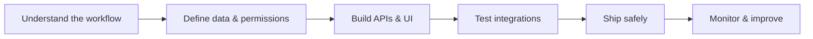

# Fartash Mirmasoumi | فرتاش میرمصومی
### Full-Stack Software Engineer · Backend, Automation & DevOps

**I build the software behind real business operations — from usable interfaces to reliable APIs, integrations and infrastructure.**

**توسعه نرم‌افزارهای کاربردی، اتوماسیون فرایندها، بک‌اند امن و زیرساخت قابل نگهداشت**

[Hamava Voltage](https://github.com/HamavaELV) · [Company website](https://hamavaelv.ir) · [Engineering case studies](#selected-engineering-work) · [Contact](mailto:fartash@hamavaelv.ir)

---

## Hello! | درباره من

I work on the full journey of an application: **understanding the real-world workflow, structuring the data, implementing an API, connecting external services, testing the edge cases and preparing responsible deployment**.

My focus is not just making a screen work. It is making the overall experience understandable for the user and dependable for the people operating it.

**فارسی:** در حوزه بک‌اند، توسعه وب، یکپارچه‌سازی سرویس‌ها و DevOps کار می‌کنم. تلاش می‌کنم مسائل واقعی کسب‌وکار را به سامانه‌هایی تبدیل کنم که استفاده از آن‌ها ساده، امنیتشان قابل بررسی و نگهداری‌شان عملی باشد.

> Most commercial products are developed in **private team repositories**. Instead of exposing proprietary source, the linked public case studies explain user journeys, architecture, engineering decisions and the boundaries of each project.

## Selected engineering work

Each example answers three practical questions: **What was the problem? What does the user actually do? What engineering was involved?**

### 01 — Secure attendance for field teams

**Problem:** A basic “I am here” button does not provide sufficient evidence of identity or location for distributed project teams.

**User journey:** A worker opens a Telegram Mini App, verifies their session, captures several fresh location samples and a live selfie, and receives a server-side attendance decision. Ambiguous evidence is rejected.

**Engineering contribution described in the case study:** Backend attendance policy, Telegram identity, GPS/geofence checks, data and media boundaries, CRM/automation handoff, and deployment/testing preparation.

**Tech:** Next.js · FastAPI · PostgreSQL · MinIO · n8n

[Read the attendance case study](https://github.com/1fartash/hamavayar-attendance-case-study)

### 02 — Customer support connected to CRM

**Problem:** Customers need one place to open and track requests; support staff need to keep their existing CRM processes.

**User journey:** A customer signs in, submits a ticket with an attachment and receives updates while background workers reconcile the request with CRM and retry recoverable integration failures.

**Engineering contribution described in the case study:** Django APIs, account/ticket workflows, storage, background jobs, CRM synchronization and operational deployment boundaries.

**Tech:** Django · React · PostgreSQL · Redis · Celery · CRM24/Vtiger

[Read the customer support case study](https://github.com/1fartash/customer-support-crm-case-study)

### 03 — ELV customer platform & network mapping

**Problem:** Consultation, product selection, technical drawings and project quantities often happen in disconnected tools.

**User journey:** A customer requests an ELV service. The engineering team maps devices, organizes equipment records, prepares quantities and coordinates site activities.

**Engineering contribution described in the case study:** Customer and engineering domain structure, project-scoped permissions, mapping/BOQ workflows, application integration boundaries and technical documentation.

**Tech:** Next.js · TypeScript · Supabase · Django

[Read the ELV engineering case study](https://github.com/1fartash/elv-platform-network-mapping-case-study)

### 04 — Persian-first corporate website

**Problem:** A non-technical customer needs to understand specialized electrical and network services quickly, especially on mobile.

**User journey:** A visitor explores clear service descriptions, reviews FAQs and technical articles, and reaches an understandable consultation path.

**Engineering contribution described in the case study:** Reusable RTL frontend, information architecture, validated forms, routing, metadata, build and deployment configuration.

**Tech:** React · TypeScript · Vite · Tailwind CSS

[Read the corporate website case study](https://github.com/1fartash/persian-rtl-corporate-web-case-study)

### 05 — Genetic algorithm for load balancing (research prototype)

**Problem:** Unequal processing capacity across service instances can make a naive allocation of tasks inefficient.

**Engineering approach:** Simulate candidate request-to-service assignments in Python, evaluate each assignment by makespan, and improve candidates with genetic algorithm selection, crossover and mutation.

**Scope:** A reproducible simulation and optimization experiment — **not** a deployed production load balancer or an evidence-backed performance guarantee.

**Tech:** Python · NumPy · optimization

[Explore the simulation repository](https://github.com/1fartash/GA-Microservices-LoadBalancer)

## Team projects at Hamava Voltage | پروژه‌های تیمی

I contribute to software work at **[Hamava Voltage](https://github.com/HamavaELV)**, where the wider engineering portfolio includes:

| Product | What it is for |
| --- | --- |
| **XRM** | Organizations, relationships, assets, service processes and configurable workflows |
| **HamDirect** | Instagram engagement rule drafts, page access management and guarded Meta integrations |
| **VISISTECH** | Specialized online commerce for network and ELV equipment |
| **Hamava Design** | Building-system design and engineering workflow vision |
| **Furnish** | Kitchen/cabinet planning, design versions and material workflows |
| **HamavaYar** | Attendance, staff tasks, reporting and performance management |
| **Hamava Support** | Customer tickets, support history and CRM integration |
| **VISIS Platform** | ELV customer services and network engineering maps |

These are **organizational/team products**. Their presence here does not mean I solely developed every feature or that every catalog feature is live.

For details, including distinctions between **product vision, tracked implementation and deployment verification**, see the [HamavaELV organization profile](https://github.com/HamavaELV) and its [public engineering case studies](https://github.com/orgs/HamavaELV/repositories?q=case-study).

## How I engineer | روش کار

- **Secure foundations:** Authentication, authorization, least privilege and carefully scoped records.
- **Reliable data:** PostgreSQL, schema migrations, transactional integrity and auditable events.
- **Resilient integrations:** CRM, messaging, payment and third-party APIs with explicit retry and failure behavior.
- **Practical operations:** Docker, Linux, service health, controlled releases and rollback thinking.
- **Human usability:** Persian/RTL interfaces, responsive design and clear task flows.

## Technology I work with

| Area | Tools and technologies |
| --- | --- |
| Backend | Python · Django · FastAPI · SQLAlchemy |
| Frontend | React · Next.js · TypeScript · Vite · Tailwind CSS |
| Data & background work | PostgreSQL · Redis · Celery · RabbitMQ |
| Identity & integration | OIDC/Keycloak · REST APIs · CRM24/Vtiger · Telegram · n8n |
| Deployment & storage | Docker · Linux · Reverse proxies · MinIO/S3 |
| Quality | Automated tests · API contracts · Source review · Release checks |

## Collaboration & contact

I am interested in **full-stack development, backend/API work, operational automation, integration projects and practical DevOps**.

**Email:** [fartash@hamavaelv.ir](mailto:fartash@hamavaelv.ir) · **Engineering organization:** [HamavaELV](https://github.com/HamavaELV) · **Website:** [hamavaelv.ir](https://hamavaelv.ir)

Portfolio updated November 2026. Public case studies are descriptions of private engineering work. No confidential code, credentials, private client records or unverified business performance claims are presented here.
